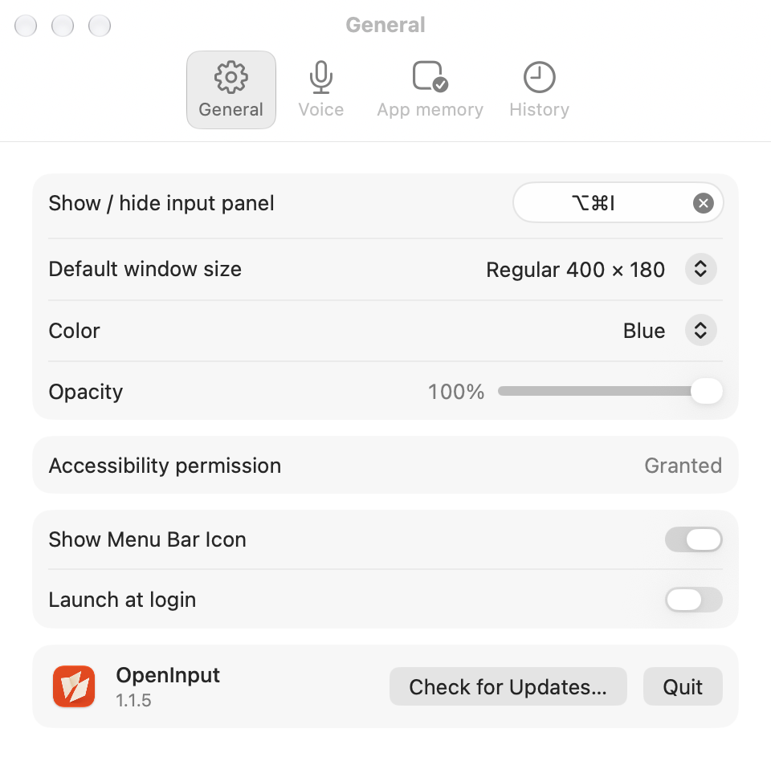

# OpenInput

<p align="center"></p>

原生 macOS 智能输入小窗。为地址栏、聊天框、邮件主题行等单行输入框提供舒适的编辑空间，按 Return 后粘贴回原输入框。

[English](README.md)

## 功能

- 全局快捷键显示、隐藏小窗，默认 `⌥⌘I`。
- 记住目标输入位置，确认提交后粘贴回原处。
- macOS 26 起支持本机语音听写，旧系统禁用听写控件。
- 可选提交时在本机清理文字；清理改过文本时可从菜单栏还原。
- `⇧↩` 换行，Tab 插入制表符。
- 历史浏览、搜索和删除。
- 记住各应用的自动弹出偏好；主动关闭会关闭该应用的自动弹出。
- 可调整小窗尺寸、边框颜色、透明度并记忆尺寸。
- 可选开机自启。
- 可隐藏菜单栏图标，随后可从恢复主窗口找回。

## 安装

需要 macOS 14 或更高版本，语音听写需要 macOS 26。下载并打开已签名、公证的安装镜像：

```bash
curl -fL https://github.com/x0c/OpenInput/releases/download/v1.1.5/OpenInput-1.1.5.dmg -o /tmp/OpenInput.dmg && open /tmp/OpenInput.dmg
```

将 OpenInput 拖入“应用程序”。[其他版本](https://github.com/x0c/OpenInput/releases)。后续版本通过应用内自动更新提供。

## 设置



## 从源码构建

```bash
git clone https://github.com/x0c/OpenInput.git
cd OpenInput
xcodegen generate
open OpenInput.xcodeproj
```

命令行构建：

```bash
xcodegen generate
xcodebuild -scheme OpenInput -configuration Debug build
```

## 使用

1. 启动后就绪菜单栏图标，没有程序坞图标。
2. 在系统设置 → 隐私与安全性中允许辅助功能权限，以便向其他应用粘贴。首次开启听写时系统另行询问麦克风权限。
3. 按 `⌥⌘I` 呼出小窗。
4. Return 插入并关闭，Shift-Return 换行，Escape 关闭；空白或历史浏览时用上下键浏览历史。麦克风开启后，每次打开小窗会开始听写。

## 隐私与权限

- 辅助功能权限用于向原目标应用发送粘贴操作。
- 麦克风仅用于本机转文字，听写和清理不向网络服务发送音频或文本。
- 历史与应用记忆保存在本机 Application Support 中。
- 为支持全局快捷键和跨应用粘贴，应用未启用沙盒。

## 许可

MIT，见 [LICENSE](LICENSE)。
